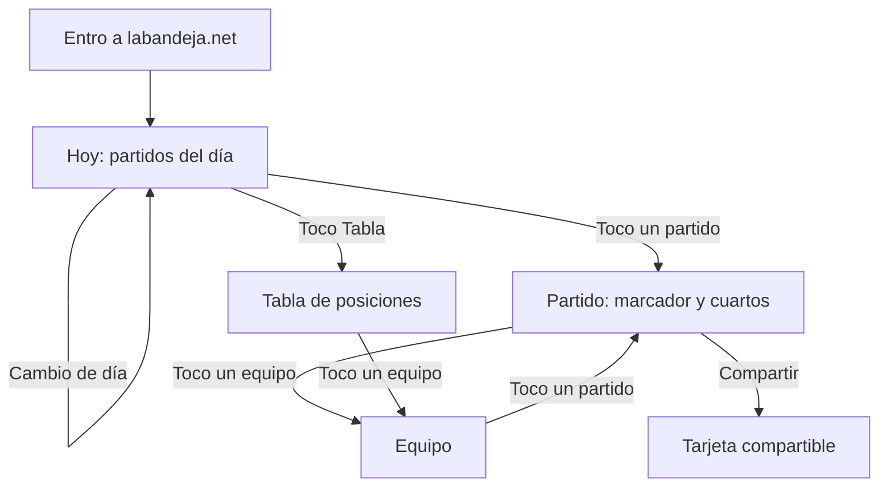

# 03 · Flujos y pantallas

> Fase 1 · Diseño sin código. Este documento es un **punto de partida**: tus bocetos propios (en papel o Figma) lo corrigen y lo reemplazan.
> Los nombres de equipos son ficticios ("Equipo A", "Equipo B") a propósito: acá no hay datos reales.

**Última revisión:** 2026-10-27

---

## Principios de diseño

1. **Mobile-first**: se diseña para un celular chico (unos 360 px de ancho) y después se adapta a pantallas grandes.
2. **Dos toques o menos** para llegar a lo importante: qué partidos hay, cómo salieron y cómo está la tabla.
3. **Cada dato dice de dónde viene y cuándo se actualizó.**
4. **Nada depende solo del color**: los estados también se escriben ("FINAL", "EN JUEGO").

## Mapa del sitio

| Pantalla | Ruta | Para qué sirve |
|---|---|---|
| Hoy | `/` | Partidos del día, con selector de día |
| Partido | `/partido/[id]` | Marcador, parcial por cuarto, hora y sede |
| Tabla | `/tabla/[competicion]` (ej. `/tabla/liga-nacional`) | Posiciones de la competencia |
| Equipo | `/equipo/[slug]` | Próximo partido y últimos resultados |
| Fuentes | `/fuentes` | De dónde salen los datos y aviso de sitio no oficial |
| Privacidad | `/privacidad` | Qué datos se guardan |

**Decisión:** el *fixture por fecha* no tiene pantalla propia en el MVP. Se cubre con el selector de día en **Hoy** y con la lista de partidos en **Equipo**. Así hay menos pantallas que construir y mantener.

## Flujo principal



Navegación fija abajo en todas las pantallas: **Hoy · Tabla**. (Una pestaña "Equipos" se evalúa después; por ahora a los equipos se llega desde la tabla y los partidos.)

---

## Pantalla 1 · Hoy

**Objetivo:** que en 2 segundos se vea qué partidos hay y cómo van o salieron.

**Qué muestra:** selector de día (‹ Hoy ›), partidos agrupados por competencia, cada uno con estado, equipos y marcador. Al pie: fuente y hora de actualización.

**Acciones:** cambiar de día, tocar un partido, ir a Tabla.

```
┌────────────────────────────────┐
│ La Bandeja                     │
├────────────────────────────────┤
│  ‹    Hoy · mar 27 oct     ›   │
├────────────────────────────────┤
│ LIGA NACIONAL                  │
│ ┌────────────────────────────┐ │
│ │ FINAL                      │ │
│ │ Equipo A               84  │ │
│ │ Equipo B               79  │ │
│ └────────────────────────────┘ │
│ ┌────────────────────────────┐ │
│ │ EN JUEGO · Cuarto 3        │ │
│ │ Equipo C               54  │ │
│ │ Equipo D               51  │ │
│ └────────────────────────────┘ │
│ ┌────────────────────────────┐ │
│ │ 21:00                      │ │
│ │ Equipo E                –  │ │
│ │ Equipo F                –  │ │
│ └────────────────────────────┘ │
├────────────────────────────────┤
│ Fuente: ___ · Actualizado 14:32│
├────────────────────────────────┤
│   [ Hoy ]        [ Tabla ]     │
└────────────────────────────────┘
```

**Estados a diseñar:** cargando · no hay partidos hoy (mostrar el próximo día con partidos) · error al cargar (mostrar la última actualización conocida) · partido postergado o suspendido.

## Pantalla 2 · Partido

**Objetivo:** ver cómo salió o cómo va, cuarto por cuarto.

**Qué muestra:** competencia y fecha del torneo, estado, marcador, día, hora y sede, tabla de puntos por cuarto, botón de compartir.

```
┌────────────────────────────────┐
│ ‹ Volver                       │
├────────────────────────────────┤
│ Liga Nacional · Fecha 5        │
│ FINAL                          │
│ Equipo A                    84 │
│ Equipo B                    79 │
│ mar 27 oct · 21:00 · Estadio X │
├────────────────────────────────┤
│ Por cuarto                     │
│          1    2    3    4  Tot │
│ Equipo A 20   22   18   24  84 │
│ Equipo B 18   20   21   20  79 │
├────────────────────────────────┤
│ [ Compartir ]                  │
│ Fuente: ___ · Actualizado 23:10│
└────────────────────────────────┘
```

**Estados:** programado (sin cuartos todavía) · en juego (cuartos parciales) · final · suspendido.

## Pantalla 3 · Tabla

**Objetivo:** ver cómo está la competencia de un vistazo.

**Qué muestra:** posición, equipo, partidos jugados, ganados, perdidos, diferencia de puntos y puntos de tabla.

```
┌────────────────────────────────┐
│ Tabla · Liga Nacional          │
├────────────────────────────────┤
│ #  Equipo       PJ  G  P  Dif Pts│
│ 1  Equipo A      5  5  0  +42  10│
│ 2  Equipo B      5  4  1  +18   9│
│ 3  Equipo C      5  3  2   +5   8│
│ …                              │
├────────────────────────────────┤
│ Fuente: ___ · Actualizado 23:10│
├────────────────────────────────┤
│   [ Hoy ]        [ Tabla ]     │
└────────────────────────────────┘
```

> ⚠️ **Verificar:** el sistema de puntos de tabla y los criterios de desempate dependen del reglamento de cada competencia. Hay que confirmarlos con una fuente oficial antes de programar el cálculo (Fase 5).

**Decisión de diseño:** en pantallas angostas se mantienen pocas columnas para no tener scroll horizontal. Las columnas extra (por ejemplo, últimos 5) se agregan solo en pantallas anchas.

## Pantalla 4 · Equipo

**Objetivo:** ver el momento de un equipo.

**Qué muestra:** nombre, competencia y posición, próximo partido y últimos resultados.

```
┌────────────────────────────────┐
│ ‹ Volver                       │
├────────────────────────────────┤
│ Equipo A                       │
│ Liga Nacional · 1.º · 5-0      │
├────────────────────────────────┤
│ Próximo partido                │
│ mié 29 oct · 21:00 vs Equipo C │
├────────────────────────────────┤
│ Últimos resultados             │
│ G  84-79  vs Equipo B          │
│ G  90-71  vs Equipo D          │
│ …                              │
├────────────────────────────────┤
│ Fuente: ___ · Actualizado 23:10│
└────────────────────────────────┘
```

**Queda afuera del MVP:** plantel y fotos de jugadores (requieren fuente y permisos).

---

## Datos que necesita cada pantalla

Esto conecta el diseño con la base de datos de la Fase 3.

| Dato | Lo usan |
|---|---|
| Equipo: nombre, slug, abreviatura, color | Todas |
| Competencia y temporada | Hoy, Tabla, Equipo |
| Partido: fecha y hora, local, visitante, estado, puntos, sede | Hoy, Partido, Equipo |
| Puntos por cuarto de cada equipo | Partido |
| Fuente y fecha de actualización de cada dato | Todas |
| Tabla de posiciones | Se **calcula** a partir de los partidos |

## Tu ejercicio

Dibujá tu propia versión de las 4 pantallas. Cambiá lo que no te convenza: el orden, qué se ve primero, qué sobra. Guardá las fotos o imágenes en `docs/diseno/` (`hoy`, `partido`, `tabla`, `equipo`) y anotá acá qué cambiaste y por qué.

✏️ **COMPLETAR:** qué cambié respecto a este documento y por qué: ___
